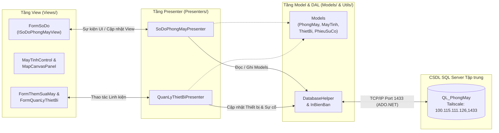

# 🖥️ HỆ THỐNG QUẢN LÝ SƠ ĐỒ VỊ TRÍ & CẤU HÌNH THIẾT BỊ PHÒNG MÁY

> **Học phần:** Lập trình trên Windows (COMP1060) — Khoa Công nghệ Thông tin, Trường Đại học Sư phạm TP. Hồ Chí Minh (HCMUE)  
> **Giảng viên hướng dẫn:** Thạc sỹ Lê Thanh Thoại  
> **Nền tảng công nghệ:** C# .NET 10.0 Windows Forms (`PerMonitorV2` High-DPI) • ADO.NET (`Microsoft.Data.SqlClient`) • SQL Server 2022 • Mạng riêng ảo Mesh VPN Tailscale (`100.115.111.126,1433`)

---

## 📌 1. Giới thiệu Dự án

**QuanLyPhongMay** là phần mềm Desktop Windows Forms quản lý trực quan sơ đồ không gian 2D, cấu hình linh kiện phần cứng và quy trình báo cáo – bảo trì sự cố cho hệ thống phòng máy thực hành tại trường đại học.

### Điểm nổi bật của hệ thống
- **Sơ đồ không gian 2D tương tác trực tiếp (GDI+ Double-Buffered Canvas):** Kéo thả máy trạm theo tọa độ thực tế `(ToaDoX, ToaDoY)`, hút lưới thông minh (`Snap-to-Grid 20px`), khóa/mở khóa vị trí từng máy hoặc toàn phòng.
- **Bản đồ mặt bằng nền theo từng phòng (`Room Floor-Plan Background Map`):** Cho phép nhập ảnh sơ đồ kiến trúc thực tế (`.png`, `.jpg`, `.bmp`) hoặc khởi tạo bản đồ mặt bằng mẫu có cửa ra vào, bàn giảng viên, lối đi và dãy bàn thực hành để đặt máy đúng vị trí địa lý.
- **Co giãn giao diện động & Tối ưu hóa High-DPI (`PerMonitorV2`):** Thanh công cụ (Toolbar), thẻ thống kê (Header Badges), bảng điều khiển bên phải (Sidebar) và các ô máy tính (`MayTinhControl`) tự động co giãn kích thước và phông chữ theo độ phân giải màn hình của từng máy (100%, 125%, 150%, 4K).
- **Quản lý Linh kiện & Tự động lập Phiếu Sự cố:** Theo dõi chi tiết từng linh kiện gắn trên máy (`Màn hình`, `CPU`, `RAM`, `VGA`, `SSD`, `Bàn phím`, `Chuột`); tự động sinh `PhieuSuCo` và cảnh báo viền đỏ khi phát hiện linh kiện hỏng.
- **Kết nối CSDL Phân tán tự động qua Tailscale (`100.115.111.126,1433`):** Mọi thành viên trong nhóm khi `git clone` dự án về máy (đã bật Tailscale) đều tự động kết nối thẳng vào SQL Server trung tâm mà không cần cấu hình thủ công; hỗ trợ cơ chế `Auto-Fallback` sang SQL Server cục bộ hoặc chế độ `Offline/Demo`.

---

## 🏗️ 2. Kiến trúc Phần mềm theo Mô hình MVP (Model – View – Presenter)

Dự án được tổ chức theo kiến trúc **MVP (Model – View – Presenter)** kết hợp tầng tiện ích truy xuất dữ liệu (`Utils / DAL`), giúp tách biệt rõ ràng giữa **Giao diện đồ họa (Views)**, **Logic điều phối nghiệp vụ (Presenters)** và **Thực thể dữ liệu (Models)**.



### Vai trò của từng thành phần trong MVP
1. **`Models/` (Data Entities & Domain Logic):**
   - Biểu diễn cấu trúc dữ liệu ánh xạ từ 7 bảng trong CSDL `QL_PhongMay` (`PhongMay`, `MayTinh`, `ThietBi`, `LoaiThietBi`, `PhieuSuCo`).
   - Cung cấp các phương thức kiểm tra trạng thái nội tại như `MayTinh.CoThietBiHuHong()`, `MayTinh.SoThietBiHuHong()`, `ThietBi.GetIcon()`.
2. **`Views/` (Passive View & Custom GDI+ Controls):**
   - Định nghĩa giao diện `ISoDoPhongMayView` và các biểu mẫu Windows Forms (`FormSoDo`, `FormThemSuaMay`, `FormQuanLyThietBi`, `FormThemThietBiMoi`).
   - Bao gồm 2 Custom Control đồ họa GDI+ chống nháy hình (`DoubleBuffered = true`): `MapCanvasPanel` (vẽ lưới tọa độ & bản đồ mặt bằng nền) và `MayTinhControl` (vẽ thẻ máy trạm & linh kiện trực tiếp trên sơ đồ).
3. **`Presenters/` (Business Logic & Coordination):**
   - `SoDoPhongMayPresenter`: Nhận sự kiện từ `ISoDoPhongMayView`, kiểm tra tính hợp lệ dữ liệu (như kiểm tra trùng mã máy toàn cục), gọi `DatabaseHelper` và cập nhật ngược lại cho View.
   - `QuanLyThietBiPresenter`: Xử lý nghiệp vụ gắn/gỡ linh kiện từ kho dự phòng, đổi trạng thái thiết bị và tự động khởi tạo `PhieuSuCo` khi linh kiện báo hỏng.
4. **`Utils/` (Data Access & Printing Services):**
   - `DatabaseHelper`: Quản lý kết nối SQL Server qua Tailscale (`100.115.111.126,1433`) kèm chuỗi dự phòng cục bộ và dữ liệu mẫu Offline.
   - `InBienBan`: Xuất và in phiếu biên bản sự cố thiết bị trực tiếp qua `System.Drawing.Printing.PrintDocument`.

---

## 📂 3. Cấu trúc Thư mục Dự án

```text
QuanLyPhongMay/
├── 📁 Models/                                # Tầng Model: Các lớp thực thể dữ liệu (Entities)
│   ├── PhongMay.cs                           # Thực thể Phòng máy (gồm cột HinhNen bản đồ mặt bằng)
│   ├── MayTinh.cs                            # Thực thể Máy trạm & danh sách thiết bị đi kèm
│   ├── ThietBi.cs                            # Thực thể Linh kiện / Thiết bị phần cứng
│   ├── LoaiThietBi.cs                        # Thực thể Danh mục loại thiết bị
│   └── PhieuSuCo.cs                          # Thực thể Phiếu báo cáo sự cố kỹ thuật
│
├── 📁 Views/                                 # Tầng View: Giao diện WinForms, Interface & Custom Controls
│   ├── ISoDoPhongMayView.cs                  # Giao diện View chuẩn MVP cho màn hình Sơ đồ phòng máy
│   ├── FormSoDo.cs                           # Màn hình chính: Sơ đồ 2D, Toolbar co giãn động & Sidebar
│   ├── FormSoDo.Designer.cs                  # Khởi tạo thành phần giao diện của FormSoDo
│   ├── MapCanvasPanel.cs                     # Custom Panel vẽ nền bản đồ mặt bằng & lưới 20px
│   ├── MayTinhControl.cs                     # Custom Control vẽ thẻ máy tính & kéo thả GDI+
│   ├── FormThemSuaMay.cs                     # Hộp thoại Thêm mới / Cập nhật thông tin máy tính
│   ├── FormQuanLyThietBi.cs                  # Hộp thoại Quản lý linh kiện của máy & Kho dự phòng
│   └── FormThemThietBiMoi.cs                 # Hộp thoại Nhập thiết bị mới vào kho
│
├── 📁 Presenters/                            # Tầng Presenter: Điều phối nghiệp vụ theo mô hình MVP
│   ├── SoDoPhongMayPresenter.cs              # Presenter điều phối màn hình Sơ đồ & CRUD Máy tính
│   └── QuanLyThietBiPresenter.cs             # Presenter điều phối Gắn/Gỡ linh kiện & Lập phiếu sự cố
│
├── 📁 Utils/                                 # Tầng Tiện ích & Truy xuất dữ liệu (DAL / Printing)
│   ├── DatabaseHelper.cs                     # Kết nối SQL Server Tailscale (100.115.111.126,1433) & CRUD
│   └── InBienBan.cs                          # Tiện ích xem trước và in Biên bản sự cố (PrintDocument)
│
├── 📁 Database/                              # Kịch bản Cơ sở dữ liệu SQL Server
│   └── QL_PhongMay_FullData.sql              # Script khởi tạo 7 bảng, khóa ngoại & nạp dữ liệu mẫu
│
├── 📁 BanChayNgay_Portable/                  # Bản đóng gói thực thi (.exe) chạy độc lập không cần Visual Studio
│   └── QuanLyPhongMay.exe                    # File thực thi chính của ứng dụng
│
├── 📁 BaoCao/                                # Toàn bộ Báo cáo học phần LaTeX, bản PDF & Sơ đồ minh họa
│   ├── BaoCao_LapTrinhWindows_QLPhongMay.tex # Mã nguồn báo cáo LaTeX
│   ├── BaoCao_LapTrinhWindows_QLPhongMay.pdf # Bản báo cáo PDF hoàn chỉnh
│   └── 📁 img/                               # Hình ảnh sơ đồ kiến trúc, ERD, UseCase, Sequence, Tailscale
│
├── 🚀 ChayNgay_QuanLyPhongMay.bat            # Script 1-click chạy ngay phần mềm (không cần mở Visual Studio)
├── 🛠️ CaiDat_QuanLyPhongMay.bat              # Bộ cài tự động tạo Shortcut ngoài Desktop & mở phần mềm
├── 📄 Program.cs                             # Điểm khởi chạy ứng dụng & cấu hình HighDpiMode.PerMonitorV2
├── 📄 QuanLyPhongMay.csproj                  # Cấu hình dự án .NET 10.0 Windows Forms
└── 📖 README.md                              # Tài liệu hướng dẫn sử dụng & kiến trúc dự án
```

---

## 🌐 4. Cấu hình Kết nối CSDL qua Tailscale VPN (`100.115.111.126,1433`)

Ứng dụng đã được tích hợp sẵn chuỗi kết nối tự động tới máy chủ SQL Server trung tâm của nhóm trong [`Utils/DatabaseHelper.cs`](Utils/DatabaseHelper.cs):

| Thông số | Giá trị cấu hình mặc định |
| :--- | :--- |
| **Máy chủ (Tailscale IP & Port)** | `100.115.111.126,1433` (`DESKTOP-2JE35CG\SQLEXPRESS`) |
| **Tên Cơ sở dữ liệu** | `QL_PhongMay` |
| **Phương thức xác thực** | SQL Server Authentication (`User Id=sa; Password=123456`) |
| **Cơ chế dự phòng (Auto-Fallback)** | Tự động chuyển sang `.\SQLEXPRESS`, `localhost` hoặc chế độ `Demo/Offline` nếu chưa bật Tailscale |

### Hướng dẫn cho thành viên nhóm khi Clone từ GitHub
1. Đảm bảo máy tính đã cài đặt và bật **Tailscale VPN** (nằm trong cùng mạng Mesh VPN của nhóm).
2. Clone dự án về máy:
   ```bash
   git clone <url-repository-cua-nhom>
   cd QuanLyPhongMay
   ```
3. Mở ngay phần mềm — hệ thống sẽ tự động kết nối vào `100.115.111.126,1433` và hiển thị trạng thái **`🟢 SQL Tailscale: 100.115.111.126,1433 (QL_PhongMay)`** ở thanh trạng thái dưới cùng.
4. *(Tùy chọn)* Nếu muốn tự dựng CSDL riêng trên máy cá nhân, chỉ cần mở **SQL Server Management Studio (SSMS)** và chạy file [`Database/QL_PhongMay_FullData.sql`](Database/QL_PhongMay_FullData.sql).

---

## 🚀 5. Hướng dẫn Chạy Phần mềm

### Cách 1: Chạy ngay không cần mở Visual Studio (Khuyên dùng)
Dự án đã được đóng gói sẵn bản thực thi độc lập, bạn có thể chọn 1 trong 3 cách:
- **Chạy nhanh 1-Click:** Bấm đúp vào file **`moQuanLyPhongMay.bat`** ở thư mục gốc.
- **Cài đặt Shortcut ra Desktop:** Bấm đúp vào file **`CaiDat_QuanLyPhongMay.bat`** để tự động tạo biểu tượng **`QuanLyPhongMay`** ngoài màn hình Desktop và khởi chạy ứng dụng.
- **Mở trực tiếp file `.exe`:** Truy cập thư mục **`BanChayNgay_Portable/`** và chạy **`QuanLyPhongMay.exe`**.

### Cách 2: Chạy và phát triển trên Visual Studio 2022 / 2026 hoặc .NET CLI
1. Mở file giải pháp **`QuanLyPhongMay.slnx`** (hoặc **`QuanLyPhongMay.csproj`**) bằng Visual Studio.
2. Nhấn **`F5`** (hoặc bấm nút **Start**) để biên dịch và chạy.
3. Hoặc chạy bằng dòng lệnh Terminal / PowerShell:
   ```powershell
   dotnet build
   dotnet run
   ```
